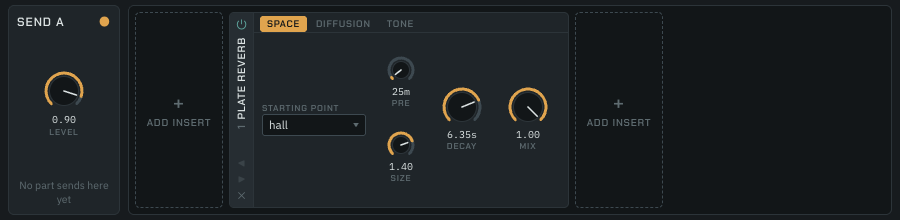
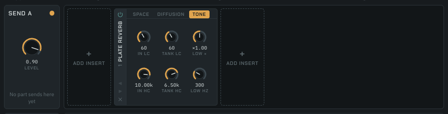
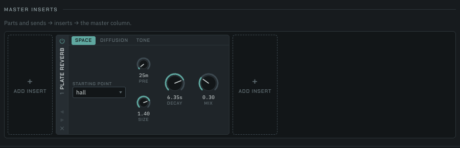
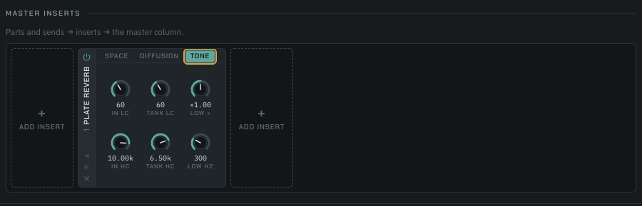

# Plate reverb: Decay in seconds, the low band, equal-power Mix

Written 2026-10-12 for windsor#748, items 1 and 6 of
`docs/research/2026-10-11-plate-reverb-upgrades/README.md`. Every figure here
was measured on the shipped bundle, `worklet/generated/reverb-processor.js`,
through the scripts in this folder. Machine: Apple M1, 16 GB. Backend: Node
24.21.0 (V8) unless a section says Chrome.

## What changed

- **Decay is an RT60 in seconds, 0.2 to 20.** Each tank line, lines 4 to 11,
  has its own gain point (`worklet/reverb/tankGains.ts`): the long lines at
  their output, where the old feedback gain sat, and the all-pass lines inside
  their all-pass, on the delayed sample both of its sums read. A line `L`
  samples long at the block's Size takes `g = 10^(−3L / (Decay·fs))`, so every
  delay `z^−L` of the loop becomes `(r z^−1)^L`: a sample loses 60 dB over
  Decay seconds whichever segments it spends them in, the all-passes' own
  recirculation included. The gains are set once a block and ramped across it
  a sample at a time, so a Decay step, a Size move or HOLD never steps the loop.
- **A measured correction** (`worklet/reverb/reverbDecayTables.ts`, below)
  stretches the gains' Decay so the broadband T30 lands on the knob's.
- **The low band** (`worklet/reverb/plateLowBand.ts`): `lowDecay` 0.25 to 4,
  default 1, and `lowCross` 80 Hz to 10 kHz, default 300. At each gain point,
  a first-order shelf from a trapezoidal one-pole lowpass at `lowCross`:
  `g·x + (gL − g)·lp`, with `gL` the gain for Decay × `lowDecay`, as the Retro
  Reverb's own band does it. At `lowDecay` exactly 1 nothing in the band runs
  and the tank takes its plain gain, which a test pins bit for bit against a
  build with the band's code out of the path (`lowBand: false`).
- **HOLD** keeps `HOLD_DECAY` at the long lines' points and passes the
  all-passes untouched, so a held tank renders exactly as it did before: the
  golden table's `hold` row kept its hash. It bypasses the band's output (its
  extra gains ramp to 0) while each lowpass keeps tracking.
- **Equal-power Mix** on the Plate insert: wet `sin(mix·π/2)`, dry
  `cos(mix·π/2)` (written `sin((1 − mix)·π/2)` so Mix 1 is exactly dry 0).
- **Format:** `ARRANGEMENT_VERSION` 10 → 11 with no upgrade.

## The spaces, before and after

Today's broadband T30 on `main` (`spacesMain.mjs`, run on `main`'s bundle):
an impulse after half a second at the space's Size (the plate starts at Size
1 and glides), Schroeder integral of L² + R², a least-squares line through −5
to −35 dB. Then each row's new `decay` and its T30 on this branch.

| Space | Old `decay` (gain) | T30 on main, 48 kHz | 44.1 kHz | New `decay` | T30 now, 48 kHz | 44.1 kHz | Change |
|---|---|---|---|---|---|---|---|
| `DEFAULT_SPACE` | 0.7 | 3.366 s | 3.387 s | 3.35 s | 3.273 s | 3.292 s | −2.8 % |
| `plate` | 0.62 | 1.240 s | 1.244 s | 1.25 s | 1.189 s | 1.194 s | −4.1 % |
| `room` | 0.45 | 0.421 s | 0.426 s | 0.40 s | 0.382 s | 0.386 s | −9.3 % |
| `hall` | 0.78 | 6.336 s | 6.377 s | 6.35 s | 6.017 s | 6.052 s | −5.0 % |
| `shimmer` | 0.85 | 4.355 s | 4.402 s | **5.05 s** | 4.342 s | 4.304 s | −0.3 % |
| `cathedral` | 0.9 | 30.376 s | 30.537 s | **20 s** | 18.712 s | 18.846 s | −38 % |
| `wash` | 0.95 | 31.372 s | 31.146 s | **20 s** | 16.245 s | 16.172 s | −48 % |

- The rows in plain type follow the issue's rule: the old T30 rounded to
  0.05 s. Their T30 now lands a little short of it because the spaces damp the
  tank (60 to 250 Hz low cuts, 4.2 to 11 kHz high cuts), which the open-damping
  correction table does not cover.
- **`shimmer`** at the rule's 4.35 s measured 3.805 s, 12.6 % short: its
  250 Hz tank low cut takes the most. It takes 5.05 s instead, the 0.05 s
  step whose T30 is nearest the old one.
- **`cathedral` and `wash`** rang about 30 s, past the 20 s ceiling, so they
  sit at 20 s. Item 8 replaces both (Old Mill about 4 s, Last Train about 8 s).
- `PLATE_REVERB_SPACE_DEFAULT` stays `hall`.

## T30 against Decay: the sweep

`sweepT30.mjs`: an impulse after half a second at the Size, `tankLowCut`
10 Hz, `tankHighCut` 20 kHz, `lowDecay` 1, modulation off, wet 1. Decay over
0.2, 0.3, 0.5, 0.7, 1, 1.5, 2.5, 4, 7, 12 and 20 s; Size over 0.05, 0.08,
0.15, 0.3, 0.6, 1, 1.7, 2.5 and 4; `diffusionTank1` and `diffusionTank2` each
over 0, 0.4 and 0.8 (nine pairs per cell). Each cell is the error range over
the nine pairs, in percent. A cell in brackets is one where one trip round
the tank (0.7254 s × Size) is a quarter of Decay or more: its tail is a few
discrete echoes, reported without a fit to hold it to. The full rows are
`sweep48.tsv` and `sweep44.tsv`.

**48 kHz:**

| Decay \ Size | 0.05 | 0.08 | 0.15 | 0.3 | 0.6 | 1 | 1.7 | 2.5 | 4 |
|---|---|---|---|---|---|---|---|---|---|
| 0.2 s | +5..+14 | (+10..+17) | (+17..+20) | (+13..+17) | (+4..+12) | (+4..+16) | (+19..+53) | (+34..+87) | (+46..+133) |
| 0.3 s | −3..+2 | +0..+4 | (+4..+5) | (+4..+7) | (−9..+1) | (−25..−8) | (−21..+3) | (−10..+36) | (+3..+85) |
| 0.5 s | −1..+1 | +1..+2 | −0 | (−0..+2) | (+3..+7) | (−11..−2) | (−40..−16) | (−46..−18) | (−34..+19) |
| 0.7 s | −0 | +0..+1 | −0 | (−0..+1) | (+3..+4) | (+2..+7) | (−20..−10) | (−49..−19) | (−53..−10) |
| 1 s | −0 | +0..+1 | −0 | −0 | (−0..+3) | (+2..+5) | (−9..+6) | (−23..−11) | (−67..−22) |
| 1.5 s | −0 | +0..+1 | −0 | −0 | (+1..+2) | (−1..+4) | (+3..+9) | (−8..+9) | (−29..−7) |
| 2.5 s | −0 | +0 | −0 | −0 | +0 | (−0..+1) | (−1..+4) | (+3..+6) | (−2..+11) |
| 4 s | −0 | +0..+1 | −0 | −0 | +0 | −0 | (−1..+0) | (−1..+3) | (+3..+7) |
| 7 s | −1..−0 | +0..+1 | −0 | −0 | +0 | −0 | −1 | (−0..+1) | (+0..+2) |
| 12 s | −0 | +0..+1 | −0..+1 | −0 | +0 | −0 | −1..−0 | −1..−0 | +0..+1 |
| 20 s | −1..+0 | +0..+1 | −0..+1 | −0..+1 | +0 | +0 | −1..−0 | −0 | −0 |

**44.1 kHz** (the table was measured at 48 kHz only):

| Decay \ Size | 0.05 | 0.08 | 0.15 | 0.3 | 0.6 | 1 | 1.7 | 2.5 | 4 |
|---|---|---|---|---|---|---|---|---|---|
| 0.2 s | +3..+12 | (+11..+18) | (+18..+21) | (+13..+18) | (+5..+12) | (+5..+17) | (+18..+52) | (+29..+85) | (+20..+112) |
| 0.3 s | −4..+1 | +2..+5 | (+4..+6) | (+5..+7) | (−8..+2) | (−25..−8) | (−22..+2) | (−14..+36) | (−7..+77) |
| 0.5 s | −3..−1 | +2..+3 | +1 | (−0..+3) | (+3..+7) | (−11..−1) | (−39..−15) | (−48..−18) | (−41..+16) |
| 0.7 s | −2 | +1..+2 | +0..+1 | (+0..+2) | (+2..+4) | (+3..+8) | (−19..−9) | (−48..−18) | (−58..−13) |
| 1 s | −2 | +1..+2 | +0..+1 | −0 | (−0..+3) | (+3..+6) | (−8..+8) | (−21..−10) | (−68..−21) |
| 1.5 s | −2..−1 | +1 | +0..+1 | −0 | (+0..+1) | (−0..+4) | (+4..+10) | (−6..+10) | (−27..−5) |
| 2.5 s | −2..−1 | +1 | +0..+1 | −0 | +0 | (+0..+1) | (+0..+5) | (+4..+7) | (+0..+12) |
| 4 s | −3..−1 | +1 | −0..+1 | −0 | −0 | +0 | (+1..+2) | (+0..+4) | (+4..+8) |
| 7 s | −4..−2 | +0..+1 | −0..+1 | −0 | −0 | +0 | +0..+1 | (+1..+2) | (+1..+3) |
| 12 s | −5..−4 | +1 | −0..+1 | −1..+0 | −0 | +0 | +0..+1 | +1 | +1..+2 |
| 20 s | −9..−7 | +1..+2 | −0..+1 | −1..+0 | −0 | +0 | +0 | +1 | +0..+1 |

- Every measured cell is within ±10 % but one: **Decay 0.2 s at Size 0.05**,
  up to +14.5 % at 48 kHz and +12.5 % at 44.1 kHz. That is a floor, not the
  tank: with the tank's own Decay set to 0.05 s the plate still measures a
  T30 of 0.18 to 0.19 s, the ring of the four input diffusers (3.6 to 12.7 ms
  at coefficients 0.75 and 0.625), which sit outside the loop and do not
  follow Decay. Item 7's plate voicing, with diffusers well under 2 ms,
  removes it.
- The tank diffusions move a cell by about 2 % at most: charging the loss on
  every segment, the all-passes' included, is what keeps them out of it.
- At 44.1 kHz the smallest Size runs a few percent short at long Decays
  (−9 % at 20 s), where the interpolating reads lose more per pass than at
  48 kHz. Still within ±10 %.

### Why a correction table

With the loss charged on every segment and the damping open, the T30 came
out short wherever the tank is passed many times a second: −27 % at Size
0.05 and Decay 20 s, −7 % at Size 4. Each pass costs a little on its own: the
damping one-poles are not transparent even at 10 Hz and 20 kHz (the low cut
takes about 0.3 dB a pass at 37.5 Hz), and every fractional read
interpolates. `decayTable.mjs` measures, per Size and Decay, the factor `f`
with `T30(Decay × f) = Decay`, by three steps of
`f ← f × Decay / T30(Decay × f)` on a bundle built with every factor 1. A
cell whose trip is a quarter of Decay or more holds the factor of the shortest
measured Decay at its Size, and a factor under 1 is held at 1 (that happens
only at Decay 0.2 s and Size 0.05, the input-diffuser floor above). The
factors run from 1 to 1.50; the table is read bilinearly in Size and
Decay.

The correction is broadband: it stretches the whole tank, so a band the
plate loses little in (the mids at small Sizes) rings up to a few percent
longer than Decay, and the top, which the interpolation and the damping take
most, rings shorter. The octave bands at `lowDecay` 1 are in the next table's
"at lowDecay 1" figures.

## The low band

`lowBand.mjs`: an impulse after half a second, damping open, modulation off.
Octave-band T30 (fourth-order Linkwitz–Riley edges) one, two and three
octaves below and above `lowCross`. Each cell: the band's centre, its T30,
the error against Decay × `lowDecay` below or Decay above, and in brackets'
second figure the error against the same band at `lowDecay` 1 (times
`lowDecay` below), which takes out the plate's own losses in that band. The
cases are chosen so that each band's decay is at least four trips: Size 0.05
at Decay 2 s, Size 1 at Decay 12 s, Size 4 at Decay 20 s. 48 kHz;
`low44.tsv` has 44.1 kHz, within a few percent of it.

| Size | Decay | lowCross | lowDecay | below 1 oct | below 2 oct | below 3 oct | above 1 oct | above 2 oct | above 3 oct |
|---|---|---|---|---|---|---|---|---|---|
| 0.05 | 2 s | 80 | 0.25 | 40 Hz: 0.73 s (47%; 68%) | 20 Hz: 0.69 s (38%; 60%) | — | 160 Hz: 1.62 s (−19%; −26%) | 320 Hz: 1.96 s (−2%; −11%) | 640 Hz: 2.08 s (4%; −4%) |
| 0.05 | 2 s | 80 | 4 | 40 Hz: 2.86 s (−64%; −59%) | 20 Hz: 2.86 s (−64%; −59%) | — | 160 Hz: 2.49 s (25%; 15%) | 320 Hz: 2.32 s (16%; 6%) | 640 Hz: 2.20 s (10%; 1%) |
| 0.05 | 2 s | 300 | 0.25 | 150 Hz: 0.77 s (54%; 42%) | 75 Hz: 0.61 s (21%; 19%) | 37.5 Hz: 0.55 s (10%; 26%) | 600 Hz: 1.56 s (−22%; −28%) | 1200 Hz: 1.77 s (−11%; −13%) | 2400 Hz: 1.67 s (−16%; −6%) |
| 0.05 | 2 s | 300 | 4 | 150 Hz: 4.78 s (−40%; −45%) | 75 Hz: 5.25 s (−34%; −35%) | 37.5 Hz: 3.89 s (−51%; −44%) | 600 Hz: 2.71 s (36%; 24%) | 1200 Hz: 2.17 s (9%; 6%) | 2400 Hz: 1.81 s (−10%; 2%) |
| 0.05 | 2 s | 10000 | 0.25 | 5000 Hz: 0.49 s (−3%; 44%) | 2500 Hz: 0.53 s (7%; 22%) | 1250 Hz: 0.55 s (11%; 9%) | — | — | — |
| 0.05 | 2 s | 10000 | 4 | 5000 Hz: 3.08 s (−62%; −43%) | 2500 Hz: 4.83 s (−40%; −31%) | 1250 Hz: 6.63 s (−17%; −18%) | — | — | — |
| 1 | 12 s | 80 | 0.25 | 40 Hz: 4.86 s (62%; 64%) | 20 Hz: 3.43 s (14%; 36%) | — | 160 Hz: 9.92 s (−17%; −24%) | 320 Hz: 11.77 s (−2%; −10%) | 640 Hz: 12.56 s (5%; −4%) |
| 1 | 12 s | 80 | 4 | 40 Hz: 23.09 s (−52%; −51%) | 20 Hz: 20.74 s (−57%; −49%) | — | 160 Hz: 15.93 s (33%; 22%) | 320 Hz: 13.84 s (15%; 5%) | 640 Hz: 13.19 s (10%; 1%) |
| 1 | 12 s | 300 | 0.25 | 150 Hz: 4.76 s (59%; 46%) | 75 Hz: 3.65 s (22%; 15%) | 37.5 Hz: 3.29 s (10%; 12%) | 600 Hz: 9.76 s (−19%; −25%) | 1200 Hz: 11.15 s (−7%; −12%) | 2400 Hz: 10.94 s (−9%; −5%) |
| 1 | 12 s | 300 | 4 | 150 Hz: 33.32 s (−31%; −36%) | 75 Hz: 37.53 s (−22%; −26%) | 37.5 Hz: 34.96 s (−27%; −26%) | 600 Hz: 16.30 s (36%; 25%) | 1200 Hz: 13.36 s (11%; 6%) | 2400 Hz: 11.69 s (−3%; 2%) |
| 1 | 12 s | 10000 | 0.25 | 5000 Hz: 3.23 s (8%; 40%) | 2500 Hz: 3.31 s (10%; 16%) | 1250 Hz: 3.32 s (11%; 6%) | — | — | — |
| 1 | 12 s | 10000 | 4 | 5000 Hz: 23.01 s (−52%; −38%) | 2500 Hz: 34.62 s (−28%; −24%) | 1250 Hz: 43.89 s (−9%; −13%) | — | — | — |
| 4 | 20 s | 80 | 0.25 | 40 Hz: 8.53 s (71%; 66%) | 20 Hz: 6.16 s (23%; 31%) | — | 160 Hz: 16.89 s (−16%; −21%) | 320 Hz: 19.66 s (−2%; −9%) | 640 Hz: 20.85 s (4%; −3%) |
| 4 | 20 s | 80 | 4 | 40 Hz: 45.65 s (−43%; −44%) | 20 Hz: 45.64 s (−43%; −39%) | — | 160 Hz: 26.82 s (34%; 25%) | 320 Hz: 22.78 s (14%; 6%) | 640 Hz: 21.77 s (9%; 1%) |
| 4 | 20 s | 300 | 0.25 | 150 Hz: 8.43 s (69%; 57%) | 75 Hz: 6.10 s (22%; 15%) | 37.5 Hz: 5.42 s (8%; 6%) | 600 Hz: 16.75 s (−16%; −22%) | 1200 Hz: 19.18 s (−4%; −9%) | 2400 Hz: 19.50 s (−3%; −3%) |
| 4 | 20 s | 300 | 4 | 150 Hz: 57.50 s (−28%; −33%) | 75 Hz: 67.71 s (−15%; −20%) | 37.5 Hz: 66.74 s (−17%; −18%) | 600 Hz: 27.11 s (36%; 26%) | 1200 Hz: 22.47 s (12%; 6%) | 2400 Hz: 20.51 s (3%; 2%) |
| 4 | 20 s | 10000 | 0.25 | 5000 Hz: 6.16 s (23%; 39%) | 2500 Hz: 5.70 s (14%; 14%) | 1250 Hz: 5.49 s (10%; 4%) | — | — | — |
| 4 | 20 s | 10000 | 4 | 5000 Hz: 48.29 s (−40%; −32%) | 2500 Hz: 65.75 s (−18%; −18%) | 1250 Hz: 77.59 s (−3%; −8%) | — | — | — |

**The issue's criterion does not hold one octave from `lowCross`, and this
is the split's order, not its tuning.** A first-order shelf's log gain moves
by `Re(lp) = 1 / (1 + (f/fc)²)` of the way from `g` to `gL` (exactly so as
`gL/g` nears 1): 0.8 an octave below `lowCross` and 0.2 an octave above. So
at `lowDecay` 4 the decay rate an octave below is `0.25 + 0.2 × 0.75 = 0.4`
of Decay's where it should be 0.25, a T30 37 % short, and an octave above it
is 0.85 of Decay's, 18 % long; at 0.25 the misses are of the same size the
other way. Moving the corner trades one side for the other. Three octaves
away the split is within 2 % of its target, which is where the Retro
Reverb's own test reads its band (`inserts/retroReverbDsp.test.ts`).

At three octaves the band holds `lowDecay` to within about ±15 % of the
same band at `lowDecay` 1 in most cases. What remains is the plate's own
per-pass loss in that band: the 10 Hz tank low cut at 20 to 40 Hz (at Size
0.05 a low band can't ring much past 4 s), and the interpolating reads above
a few kHz. Those losses are a fixed number of dB a second, so they cost a
long low decay (`lowDecay` 4) a larger share than a short one.

`mixer/reverbLowBand.test.ts` pins the band three octaves out: at Size 1,
Decay 6 s and `lowCross` 1 kHz, the 125 Hz band within 15 % of Decay ×
`lowDecay` and the 8 kHz band within 10 % of itself at `lowDecay` 1, for
`lowDecay` 0.25 and 4.

## The corners

`corners.mjs`: a 1 s noise burst into every corner of Decay 0.2 and 20 s,
`lowDecay` 0.25 and 4, Size 0.05 and 4, both tank diffusions 0 and 0.8,
`lowCross` 80 Hz and 10 kHz, HOLD off and on (on from 1.5 s to 11.5 s, then
released); damping open, modulation at its default. Full rows in
`corners48.tsv`.

- **Nothing runs away.** Three times the longest RT60 after the burst (or
  after HOLD's release), every corner is at least 17 dB under the first
  second's peak (128-sample RMS). The 17 dB ones are Decay 0.2 s at Size 4,
  where one trip takes 2.9 s, so 0.6 s after the burst its echoes are still
  arriving; every corner at Decay 20 s had decayed to the sleep floor and
  slept. No sample was non-finite.
- **HOLD holds.** Over the eight seconds held, the last second is 1 to 11 dB
  under the second second, never above it. The most is at Size 0.05, where
  the tank is passed 28 times a second and the interpolating reads take the
  top off the noise; HOLD's gains are the old ones, so this is the plate's
  HOLD as it was (the golden table's `hold` row is unchanged).

## No steps

`steps.mjs`, as the Size-sweep test measures a step (record
`2026-08-31-dattorro-reverb-not-plateau` §3): a steady 220 Hz tone at 0.3,
the move made with the tail ringing, and the largest left-channel
sample-to-sample step after the first five quanta against the tone's slew at
the render's peak, times 3. Defaults otherwise.

| Move | Largest step | Ceiling | |
|---|---|---|---|
| HOLD on at 2 s, off at 4 s, `lowDecay` 0.25 | 0.0209 | 0.0618 | pass |
| HOLD on and off, `lowDecay` 1 | 0.0297 | 0.0879 | pass |
| HOLD on and off, `lowDecay` 4 | 0.0355 | 0.1062 | pass |
| `lowDecay` 1 → 0.25 at 2 s, back at 4 s | 0.0236 | 0.0708 | pass |
| `lowDecay` 1 → 4 at 2 s, back at 4 s | 0.0352 | 0.1055 | pass |
| Decay 0.2 → 20 s at 2 s, back at 4 s | 0.0596 | 0.1781 | pass |
| Decay 20 → 0.2 s at 2 s, back at 4 s | 0.0596 | 0.1781 | pass |
| Decay 0.2 → 20 s and back, `lowDecay` 4 | 0.0684 | 0.2046 | pass |
| Steady, defaults | 0.0238 | 0.0714 | pass |

At 44.1 kHz every row passes with the same margins.

**The Size ramp 0.05 → 4 → 0.05** (`sweepSlow.mjs`) passes over 8 s each way
at `lowDecay` 0.25, 1 and 4, but not over 2 s or 4 s each way:

| Each way | `lowDecay` 1 | 0.25 | 4 |
|---|---|---|---|
| 2 s | 0.264 / 0.203 | 0.179 / 0.166 | 0.288 / 0.218 |
| 4 s | 0.244 / 0.206 | 0.126 / 0.166 | 0.309 / 0.230 |
| 8 s | 0.181 / 0.235 | 0.104 / 0.176 | 0.242 / 0.264 |

That is the sweep's Doppler, not a step. `stepLocal.mjs` finds the largest
steps of the 2 s sweep at 5.06 to 5.13 s, where Size lands back on 0.05:
runs of five neighbouring samples each within a few percent of the largest,
about three times the RMS step of the 128 samples around them, which is a
steep waveform rather than a jump. The tone's pitch there, by zero crossings,
has risen from 220 Hz to about 720 Hz, since every line shortening at 0.3 s a
second plays its contents back about 1.3 times fast, and the tail passes
several lines while the sweep runs. `main` does the same once its tail is as
long: at a feedback gain of 0.97 the same sweep reaches 1.4 kHz and a step of
0.73. The test pins the 8 s sweep.

## CPU

The plate's render per 128-frame quantum, noise in at 0.25, default space,
sleep off, after two warm-up runs; median of seven runs of 20 000 quanta
(`bench.mjs`; in Chrome the same loop run from the page). Apple M1.

| | `main` | `lowDecay` 1 | `lowDecay` 2 |
|---|---|---|---|
| Node 24.21.0 (V8) | 39.7 µs | 34.4 µs (−13 %) | 42.4 µs (+7 %) |
| Headless Chrome 155, main thread | 39.7 µs | 35.7 to 37.4 µs | 43.3 µs |

At `lowDecay` 1 the plate is cheaper than before: each all-pass's delayed
sample is read once and used twice, where it was read twice, and that saves
more than the eight extra multiplies cost. The band adds about 8 µs a
quantum: eight one-pole lowpasses a sample. The Chrome figure is the
bundle's own `process` timed on the page's main thread, not inside an
AudioWorklet.

## Allocation

`mixer/reverbAllocation.test.ts` passes unchanged in tolerance; its scenario
now also toggles `lowDecay` (so the band comes on, seeds and goes off) and
`lowCross`, and Decay moves between 3.35 and 12 s.

## Scripts

Run from the repository root, each with a bundle path, for example
`node docs/research/2026-10-12-plate-decay-seconds/sweepT30.mjs packages/engine/src/worklet/generated/reverb-processor.js 48000`.

- `plateRig.mjs`: loads a bundle, renders, T30, octave bands.
- `spacesMain.mjs`: the spaces' T30, with per-row overrides as JSON.
- `decayTable.mjs`: measures `reverbDecayTables.ts`.
- `sweepT30.mjs`: the sweep (`sweep48.tsv`, `sweep44.tsv`).
- `lowBand.mjs`: the band (`low48.tsv`, `low44.tsv`).
- `corners.mjs`: the corners (`corners48.tsv`).
- `steps.mjs`, `sweepSlow.mjs`, `stepLocal.mjs`: the step checks.
- `bench.mjs`: the CPU figures.

## The cards

In the project's headless Chrome at its default window (1200 px wide): the
Plate card on Send A (the `room` return) and a Plate insert on the master
each show 15 space knobs over their three pages (Space: Pre, Size, Decay;
Diffusion: six; Tone: the four cuts, `Low ×` and `Low Hz`). Decay reads
`6.35s`, `Low ×` reads `×1.00` and `Low Hz` `300` at their defaults, and
nothing overflows the card.

