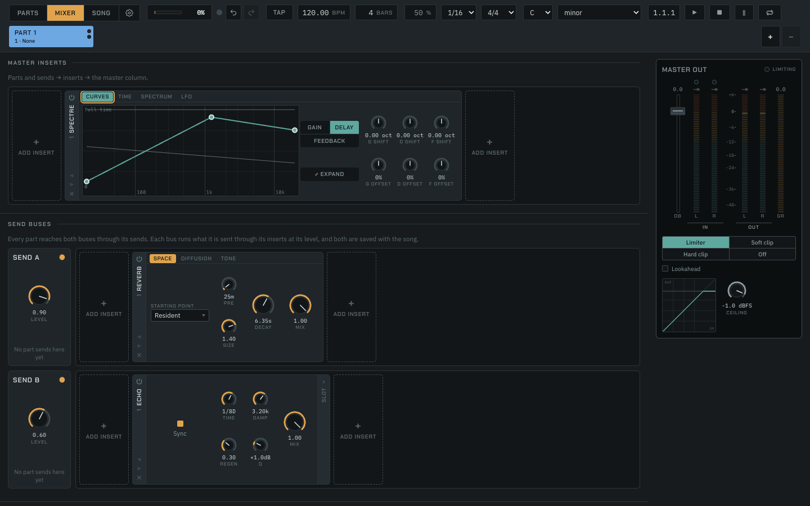
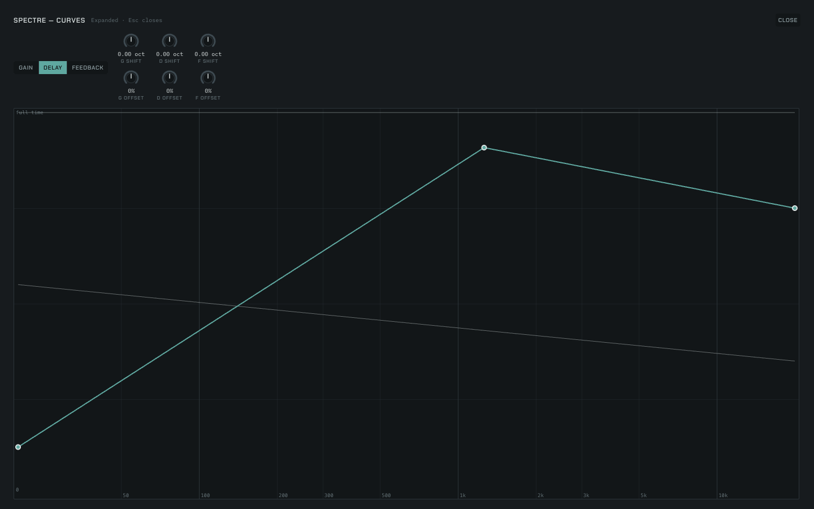

# What the Spectre insert costs

Spectre is a spectral delay (record `docs/log/2026-10-16-spectre-insert.md`).
This note measures what the shipped bundle,
`packages/engine/src/worklet/generated/spectre-processor.js`, costs in Chrome,
on the Pump's pattern (`docs/research/2026-10-13-pump-insert/`): instances on
a fresh `OfflineAudioContext`, the render's wall time over the program's
length, against the 48 kHz quantum.

**One Spectre at the defaults costs 0.038 ms a quantum, 1.4 % of the
2.667 ms budget at 48 kHz, and four cost 0.151 ms (5.7 %).** The finest
analysis (2048 bands, 4× overlap) costs 2.0 % an instance, and the coarsest
(128 bands) 1.4 %. Blur, the costliest frame-local algorithm, costs 1.6 %.
An LFO moving two curves plus a delay shift stepping every 16 quanta cost
nothing measurable over the defaults. The cost grows linearly with the
instance count.

| Mode | 1 instance | 4 instances |
|---|---|---|
| default (512 bands, 2×) | 0.0384 ms (1.44 %) | 0.1514 ms (5.68 %) |
| coarse (128 bands, 2×) | 0.0375 ms (1.41 %) | 0.1477 ms (5.54 %) |
| fine (2048 bands, 4×) | 0.0521 ms (1.95 %) | 0.2094 ms (7.85 %) |
| blur | 0.0419 ms (1.57 %) | 0.1629 ms (6.11 %) |
| moving (LFO and stepped delay shift) | 0.0389 ms (1.46 %) | 0.1515 ms (5.68 %) |

Medians of three repeats; the harness alone (the source, no Spectre) read
0.0005 ms. Every repeat is in [`measurement.json`](measurement.json).

The card at its defaults, from `npm run dev` (Mixer → Add insert → Time →
Spectre), after one point added in the wide view:



The curves opened wide (decision 13):



## Setup

- **Machine:** Apple M4 Pro (14 cores), macOS 26.5.1 (Darwin 25.5.0), Node
  24.16.0. Never quiet: other sessions shared it, and the one-minute load
  average was 2.21 before the run and 2.19 after (the 15-minute, 28, was a
  heavier run that had just finished).
- **Browser:** Google Chrome 155, arm64, headless
  (`HeadlessChrome/155.0.0.0`), launched by `bench.mjs` with a temporary
  profile, no extensions and muted output. Pages are served from
  `127.0.0.1`.
- **Backend:** `OfflineAudioContext`, 48 kHz, stereo, 128-frame quanta. The
  bloom study found the offline render thread runs the same JavaScript 2 to
  4 times slower than the real-time thread on an M1
  (`docs/research/2026-10-11-bloom-insert/README.md`), so these figures are
  on the high side of what the real-time thread spends.
- **Budget:** one quantum, **2.667 ms at 48 kHz**. A share is ms per quantum
  over that.

## Method

`bench.mjs` (the Pump's, renamed) bundles `page.ts` with esbuild, serves it
and the generated worklet bundles, launches Chrome, collects each repeat the
page posts, and writes `measurement.json`. Run it from the repository root
on Node 24:

```bash
node docs/research/2026-10-16-spectre-insert/bench.mjs
```

The program is 20 seconds: a stereo pad (three sines, A3, C♯4 and E4, at
0.08 each, the right channel detuned 0.2 %) with a 1.8 kHz click on every
beat at 120 BPM. Each node is built as the insert builds it
(`spectreInsert.ts`), with the params `spectreParameters` writes for
`DEFAULT_SPECTRE` and the mode's settings at 120 BPM.

## What this does not measure

- **The worst quantum.** A frame's FFTs, band map and delays run in the
  quantum its hop ends in, so the work is bursty: at 512 bands and 2× the
  frame falls every fourth quantum, at 2048 bands and 4× every eighth. The
  mean above spreads that over the hop. A real-time peak reading needs the
  load meter on a running page.
- **Sleep.** The program never falls silent, so the sleep's saving is not
  in these figures.
