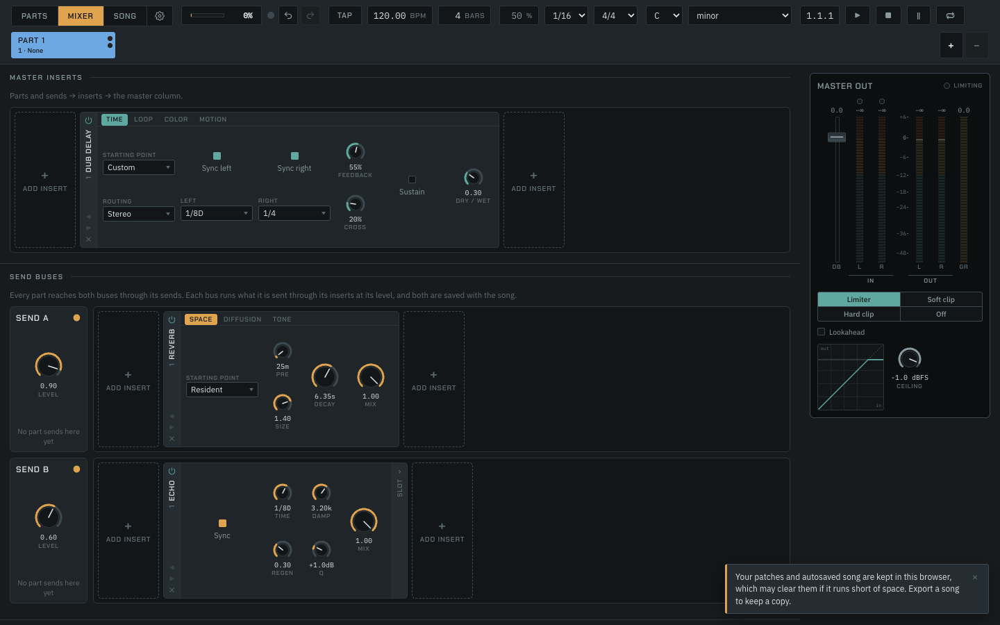
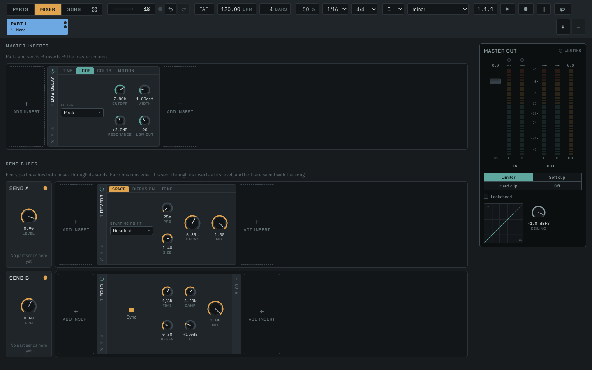

# The rebuilt Dub delay: cost, regeneration and the listen

The Dub delay's loop was rebuilt around regeneration (record
`docs/log/2026-10-17-dub-delay-regeneration.md`). This note measures what
the shipped bundle, `packages/engine/src/worklet/generated/delay-processor.js`,
costs in Chrome. It also measures how each starting point's repeats behave
once the input stops, and gives tacowars the listen.

## Cost

**One Dub delay at its defaults costs 0.023 ms a quantum, 0.86 % of the
2.667 ms budget at 48 kHz, and four cost 0.094 ms (3.5 %).** The costliest
setting measured, Fold at 30 dB of Drive into a +12 dB peak, costs 1.08 % an
instance. Sustain held, a held runaway, and the motion at its fastest and
deepest cost no more than the defaults. The cost grows linearly with the
instance count.

| Setting | 1 instance | 4 instances |
|---|---|---|
| default | 0.0231 ms (0.86 %) | 0.0938 ms (3.52 %) |
| runaway (the starting point, a held self-oscillation) | 0.0244 ms (0.91 %) | 0.0955 ms (3.58 %) |
| sustain (held from the start) | 0.0210 ms (0.79 %) | 0.0826 ms (3.10 %) |
| motion (sine, Wow 1, Sweep 4 oct, 10 Hz) | 0.0234 ms (0.88 %) | 0.0911 ms (3.42 %) |
| fold (Fold, Drive 30 dB, peak +12 dB) | 0.0289 ms (1.08 %) | 0.1066 ms (4.00 %) |

These are medians of three repeats. The harness alone (the source, no
delay) read 0.0005 ms. Every repeat is in
[`measurement.json`](measurement.json).

The old delay was not measured, so this note makes no comparison with it.

### Setup

- **Machine:** Apple M4 Pro (14 cores), macOS (Darwin 25.5.0), Node 24.16.0.
  It was never quiet: other sessions shared it, and the one-minute load
  average was about 6 before and after the run.
- **Browser:** Google Chrome, arm64, headless, launched by `bench.mjs` with a
  temporary profile, no extensions and muted output. Pages are served from
  `127.0.0.1`. The exact user agent is in `measurement.json`.
- **Backend:** `OfflineAudioContext` at 48 kHz, stereo, with 128-frame
  quanta. The offline render thread runs JavaScript slower than the
  real-time thread (`docs/research/2026-10-11-bloom-insert/README.md`), so
  these figures are on the high side of what a live mix spends.
- **Budget:** one quantum, 2.667 ms at 48 kHz. A share is ms per quantum
  over that.

### Method

`bench.mjs` is the Spectre insert's bench, with its names changed. It
bundles `page.ts` with esbuild, serves it and the generated worklet bundles,
launches Chrome, collects each repeat the page posts, and writes
`measurement.json`. Each repeat renders 20 s of a stereo pad with a click on
every beat through N instances on a fresh context, with parameters from
`delayParameters`, as the insert writes them.

```
node docs/research/2026-10-17-dub-delay-regeneration/bench.mjs
```

## The card

The card on the master inserts, from `npm run dev` (Mixer → Add insert →
Time → Dub delay), at its defaults:



The Loop page with the Peak shape, which shows Width:



## How the starting points regenerate

`listen.mjs` renders each starting point over a 75 BPM skank-and-rim
program: 4 bars played, then 4 bars of silence. The table gives the left
channel's RMS per bar, in dBFS. Mix is 0.45, except Runaway with Sustain
at 0.5.

| Render | 1 | 2 | 3 | 4 | 5 | 6 | 7 | 8 |
|---|---|---|---|---|---|---|---|---|
| Tape echo | −37 | −37 | −37 | −37 | −48 | −85 | −121 | −180 |
| Bucket brigade | −37 | −36 | −36 | −36 | −44 | −66 | −85 | −101 |
| Roots dub | −38 | −37 | −37 | −37 | −45 | −54 | −63 | −70 |
| Telephone | −38 | −38 | −37 | −38 | −51 | −75 | −97 | −122 |
| Runaway | −26 | −14 | −12 | −12 | −12 | −12 | −12 | −12 |
| Sub engine | −18 | −14 | −14 | −14 | −14 | −12 | −12 | −12 |
| Roots dub, Feedback ridden 0.6 → 1 over bars 2–6 | −38 | −38 | −37 | −37 | −43 | −45 | −44 | −43 |
| Runaway, Sustain bars 4–6, cutoff swept 400 Hz → 1.6 kHz | −27 | −15 | −12 | −11 | −11 | −11 | −11 | −11 |

What the rows show:

- **The decaying starting points decay**, from Tape echo's quick fade to
  Roots dub's long throw, about 8 dB a bar.
- **Runaway and Sub engine** are lifted past unity by their resonance. They
  grow for a bar and then hold, steady to within a dB, after the input has
  stopped. That is the governor's ceiling, with the saturation thinning the
  peak.
- **Riding Roots dub's Feedback to unity** turns its decay into a held loop
  about 7 dB under the playing level. This is the "push the regen" gesture.

A first draft of Roots dub (Feedback 0.84, Resonance 4 dB) and Telephone
(0.72, 6 dB) held as well, at −35 and −21 dBFS. A dub throw should decay
until it is pushed, so both were lowered to the values the table shows.

### The listen

```
node docs/research/2026-10-17-dub-delay-regeneration/listen.mjs [--out ~/Desktop/dub-delay]
```

It writes stereo 48 kHz WAVs outside the repository:

- `preset-<id>.wav`: each starting point;
- `ride-feedback.wav`: Roots dub, with Feedback ridden to unity;
- `runaway-sustain.wav`: Runaway, with Sustain pressed at bar 4, its cutoff
  swept while held, and released at bar 7.

The source is synthetic and deterministic, and the parameters are written by
the engine's own `delayParameters` and starting points.
