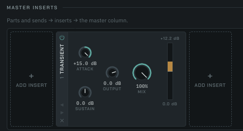

# The Transient insert: the sweep, the cost and the listen (windsor#897)

Transient is a transient shaper with no threshold (record
`docs/log/2026-10-18-transient-insert.md`): Attack lifts or softens each
hit's front, Sustain lengthens or shortens its decay, by the envelope
difference of three followers of one window peak. This note tables the
shipped bundle, `packages/engine/src/worklet/generated/transient-processor.js`,
at every bound of the controls that interact (Attack, Sustain, Mix, Output,
the switch, the timing row and the rate), measures what it costs in Chrome,
and lists the listen.

**In short.** A hit at Attack +15 takes +14.98 dB on its onset sample, and at
Sustain −24 its tail 200 ms in is cut by 20.4 dB, on the shipped `medium`
row. A held tone takes 0.00 dB at every bound. The same hit at 0, −20 and
−40 dBFS takes the same gain to within 1.2e-6 dB. A steady sine at or above
`1/(2·hold)` ripples the gain by at most 0.0002 dB under every row; below
it (30 Hz on `tight`) by 0.3 to 0.5 dB. The onset and decay gains agree
across 44.1, 48 and 96 kHz to within 0.012 dB. Four instances cost 0.027 ms
of a 48 kHz quantum, 1.0 % of its budget, on an M4 Pro. Every binding check
holds, so there is no deviation from the issue's decisions.

## Method

`sweep.mjs` renders the shipped bundle under Node through `transientBundle.mjs`
(the bundle evaluated with the worklet scope's three names shimmed, as the
tests' harness does) and prints the tables below:

```bash
node docs/research/2026-10-18-transient-insert/sweep.mjs
```

- **The hit:** silence, then an instant rise to 0.5 and an exponential
  decay with τ = 80 ms, on a 220 Hz cosine that starts at its crest, so the
  onset, 50 ms and 200 ms are all crests. A gain is that sample's output over
  its input, in dB, and includes Mix and Output.
- **The held tone:** a 220 Hz sine at 0.5 for 2 s, read at its last crest.
- **Low notes:** a sine at 0.5 for 3 s; the ripple is the gain's swing over
  the last second, on samples above 0.05.
- **Live moves:** the switch off at 20 ms and back on at 120 ms into the hit,
  and Attack swept −15 to +15 a quantum at a time from 50 to 150 ms, as a
  lane writes it; each move's largest sample-to-sample step over its 30 ms
  (the sweep's whole span), beside the same settings left still and the
  input's own steps in that span.

The binding checks are tests on the same bundle: `inserts/transientDsp.test.ts`
(neutral, off, the onset and tail numbers, level independence, ripple, rates,
the linked stereo and the meter), `transientSleep.test.ts`,
`transientAllocation.test.ts`, `transientGolden.test.ts`,
`transientMusical.test.ts` and `transientInsert.test.ts`.

## The sweep

### Bounds (shipped row)

| Attack | Sustain | Mix | Onset | 50 ms | 200 ms | Held tone |
|---:|---:|---:|---:|---:|---:|---:|
| -15 | -24 | 1 | -14.98 | -5.41 | -20.37 | 0.00 |
| -15 | 0 | 1 | -14.98 | 0.00 | 0.00 | 0.00 |
| -15 | 24 | 1 | -14.98 | 5.41 | 20.37 | 0.00 |
| 0 | -24 | 1 | 0.00 | -5.41 | -20.37 | 0.00 |
| 0 | 0 | 1 | 0.00 | 0.00 | 0.00 | 0.00 |
| 0 | 24 | 1 | 0.00 | 5.41 | 20.37 | 0.00 |
| 15 | -24 | 1 | 14.98 | -5.41 | -20.37 | 0.00 |
| 15 | 0 | 1 | 14.98 | 0.00 | 0.00 | 0.00 |
| 15 | 24 | 1 | 14.98 | 5.41 | 20.37 | 0.00 |
| -15 | -24 | 0.5 | -4.60 | -2.29 | -5.23 | 0.00 |
| -15 | 0 | 0.5 | -4.60 | 0.00 | 0.00 | 0.00 |
| -15 | 24 | 0.5 | -4.60 | 3.12 | 15.14 | 0.00 |
| 0 | -24 | 0.5 | 0.00 | -2.29 | -5.23 | 0.00 |
| 0 | 0 | 0.5 | 0.00 | 0.00 | 0.00 | 0.00 |
| 0 | 24 | 0.5 | 0.00 | 3.12 | 15.14 | 0.00 |
| 15 | -24 | 0.5 | 10.38 | -2.29 | -5.23 | 0.00 |
| 15 | 0 | 0.5 | 10.38 | 0.00 | 0.00 | 0.00 |
| 15 | 24 | 0.5 | 10.38 | 3.12 | 15.14 | 0.00 |

### Level independence

| Attack | Sustain | Largest difference, 0 to 1 s |
|---:|---:|---:|
| 15 | 0 | 8.6e-7 dB |
| 0 | -24 | 1.2e-6 dB |
| 0 | 24 | 1.2e-6 dB |
| 10 | -12 | 9.9e-7 dB |
| -15 | 24 | 1.2e-6 dB |

### Low notes

| Row | hold | 1/(2·hold) | Hz | Attack +15 | Sustain +24 |
|---|---:|---:|---:|---:|---:|
| tight | 12 ms | 41.7 Hz | 30 (below) | 0.3038 dB | 0.5278 dB |
| tight | 12 ms | 41.7 Hz | 42 | 0.0000 dB | 0.0001 dB |
| tight | 12 ms | 41.7 Hz | 55 | 0.0001 dB | 0.0001 dB |
| tight | 12 ms | 41.7 Hz | 110 | 0.0001 dB | 0.0002 dB |
| medium | 20 ms | 25.0 Hz | 30 | 0.0000 dB | 0.0000 dB |
| medium | 20 ms | 25.0 Hz | 42 | 0.0000 dB | 0.0000 dB |
| medium | 20 ms | 25.0 Hz | 55 | 0.0000 dB | 0.0000 dB |
| medium | 20 ms | 25.0 Hz | 110 | 0.0000 dB | 0.0000 dB |
| loose | 25 ms | 20.0 Hz | 30 | 0.0000 dB | 0.0000 dB |
| loose | 25 ms | 20.0 Hz | 42 | 0.0000 dB | 0.0000 dB |
| loose | 25 ms | 20.0 Hz | 55 | 0.0000 dB | 0.0000 dB |
| loose | 25 ms | 20.0 Hz | 110 | 0.0000 dB | 0.0000 dB |

### Live moves

| Move | Settings | Largest step | Still | The input's own |
|---|---|---:|---:|---:|
| Off at 20 ms | attack 15 | 0.0182 | 0.0182 | 0.0113 |
| On at 120 ms | attack 15 | 0.0100 | 0.0031 | 0.0031 |
| Off at 20 ms | sustain 24 | 0.0113 | 0.0142 | 0.0113 |
| On at 120 ms | sustain 24 | 0.0031 | 0.0191 | 0.0031 |
| Off at 20 ms | attack 10, sustain -12 | 0.0155 | 0.0155 | 0.0113 |
| On at 120 ms | attack 10, sustain -12 | 0.0067 | 0.0013 | 0.0031 |
| Off at 20 ms | attack -15, sustain -24 | 0.0104 | 0.0074 | 0.0113 |
| On at 120 ms | attack -15, sustain -24 | 0.0028 | 0.0005 | 0.0031 |
| Attack −15 to +15, 50 to 150 ms | sustain 0 | 0.0074 | 0.0074 | 0.0074 |
| Attack −15 to +15, 50 to 150 ms | sustain 24 | 0.0195 | 0.0195 | 0.0074 |

### Rates

| Settings | Point | 44.1 kHz | 48 kHz | 96 kHz | Spread |
|---|---|---:|---:|---:|---:|
| attack 15 | onset | 14.98 | 14.98 | 14.99 | 0.012 |
| attack 15 | 50 ms | 0.00 | 0.00 | 0.00 | 0.000 |
| attack 15 | 200 ms | 0.00 | 0.00 | 0.00 | 0.000 |
| attack -15 | onset | -14.98 | -14.98 | -14.99 | 0.012 |
| attack -15 | 50 ms | 0.00 | 0.00 | 0.00 | 0.000 |
| attack -15 | 200 ms | 0.00 | 0.00 | 0.00 | 0.000 |
| sustain -24 | onset | 0.00 | 0.00 | 0.00 | 0.000 |
| sustain -24 | 50 ms | -5.41 | -5.41 | -5.41 | 0.005 |
| sustain -24 | 200 ms | -20.37 | -20.37 | -20.37 | 0.001 |
| sustain 24 | onset | 0.00 | 0.00 | 0.00 | 0.000 |
| sustain 24 | 50 ms | 5.41 | 5.41 | 5.41 | 0.005 |
| sustain 24 | 200 ms | 20.37 | 20.37 | 20.37 | 0.001 |

### Timing rows

| Row | Attack +15 onset | Attack +15, 50 ms | Sustain −24, 50 ms | Sustain −24, 200 ms | Sustain +24, 200 ms |
|---|---:|---:|---:|---:|---:|
| tight | 14.96 | 0.00 | -7.80 | -19.97 | 19.97 |
| medium (ships) | 14.98 | 0.00 | -5.41 | -20.37 | 20.37 |
| loose | 14.99 | 1.63 | -3.03 | -20.06 | 20.06 |

What the tables say:

- **Bounds.** Attack acts only on the front: by 50 ms the attack reference
  has caught the follower, so Attack's gain there is 0. Sustain acts only
  after the window's `hold`, and grows as the hit decays faster than the
  sustain reference: −5.4 dB at 50 ms, −20.4 dB at 200 ms at −24. The two
  are independent, and a held tone takes neither. Mix 0.5 blends linearly:
  `0.5·gain + 0.5`.
- **Level independence** holds to float rounding, well inside 0.05 dB.
- **Low notes.** At or above `1/(2·hold)` the window always holds a crest,
  and the gain stays flat. 30 Hz on `tight` (below its 41.7 Hz) ripples,
  as decision 5 predicts.
- **Live moves.** Switching off crossfades toward the dry signal, whose
  steps are the input's own. Switching on from fully off restarts the
  detector, so the decaying hit reads as a new onset and takes the Attack
  setting for about `aAttack`: at Attack +15 its largest step is 0.0100
  against the input's 0.0031, a lift of the sound, not a click (the fade
  takes 5 ms). The Attack sweep adds no step past the still render's.
- **Rates.** The window's length and every pole are worked out from the
  rate, so the shapes agree across rates to 0.012 dB.
- **Timing rows.** `tight` starts the decay's shape soonest (−7.8 dB at
  50 ms), `loose` latest (−3.0 dB) and keeps the onset lift longest
  (+1.6 dB still at 50 ms). By 200 ms all three cut about 20 dB.

## Sleep

The floor is the plate's 1e-9 over +45 dB, the most the shaping (+15 + 24)
and the Output (+6) can add: 5.6e-12, derived in `transientConstants.ts`.
The insert sleeps once a block's input is under it and the window, the
follower and both references have released under it. Its tail is
`sRelease · ln(1/floor)`: 5.2 s on `tight`, 10.4 s on `medium` and 20.7 s on
`loose`. Asleep, it plays the input at the Output's gain with its controls
and switch stepping each sample, which is exactly what an awake insert plays
over a block that quiet (the shapes are 0 under the same floor), and a woken
insert renders within 1e-7 of one that never slept (`transientSleep.test.ts`).

## Cost

`bench.mjs` bundles `page.ts` with esbuild, serves it and the generated
bundle on 127.0.0.1, launches a muted headless Chrome with a temporary
profile, and writes [`measurement.json`](measurement.json), on the Pump's
pattern (`docs/research/2026-10-13-pump-insert/`):

```bash
node docs/research/2026-10-18-transient-insert/bench.mjs
```

- **Machine:** Apple M4 Pro (10 performance and 4 efficiency cores,
  64 GB), macOS 26.5.1 (Darwin 25.5.0), Node 24.16.0. Not quiet: other
  sessions shared it, and the one-minute load average was 9.0 before the run
  and 6.7 after.
- **Browser:** Google Chrome 155.0.8059.80, arm64, headless
  (`HeadlessChrome/155.0.0.0`).
- **Backend:** `OfflineAudioContext`, 48 kHz, stereo, 128-frame quanta.
  The offline render thread has run the same JavaScript slower than the
  real-time thread on these machines (`docs/research/2026-10-11-bloom-insert/`),
  so these figures are on the high side.
- **Program:** 20 s of a stereo pad (three sines at 0.04 each), a kick on
  every beat at 128 BPM (0.6, decaying over 120 ms from 150 to 50 Hz) and a
  noise hat on each offbeat, through N Transients in parallel. Five repeats
  a cell on a fresh context; `performance.now()` brackets `startRendering()`
  alone. **ms per quantum = render ms / 20,000 ms × 2.667 ms**, from the
  median.
- **Modes:** `neutral` (the defaults), `punch` (Attack +10, Sustain −12),
  `meter` (punch with the card's meter on) and `quiet` (punch, the program
  silent after 2 s, so each instance sleeps once its sustain reference has
  released, about 12 s in).

| Mode | Instances | Render ms, median (min–max) | ms / quantum | Share of 48 kHz quantum |
|---|---:|---:|---:|---:|
| harness | 0 | 4 (4–4) | 0.0005 | 0.02 % |
| neutral | 1 | 54 (52–61) | 0.0072 | 0.27 % |
| neutral | 4 | 201 (196–204) | 0.0267 | 1.00 % |
| neutral | 16 | 787 (783–788) | 0.1049 | 3.94 % |
| punch | 1 | 52 (52–54) | 0.0070 | 0.26 % |
| punch | 4 | 197 (196–201) | 0.0262 | 0.98 % |
| punch | 16 | 803 (790–839) | 0.1070 | 4.01 % |
| meter | 1 | 54 (53–55) | 0.0072 | 0.27 % |
| meter | 4 | 200 (199–204) | 0.0266 | 1.00 % |
| meter | 16 | 766 (755–788) | 0.1022 | 3.83 % |
| quiet | 1 | 44 (44–44) | 0.0059 | 0.22 % |
| quiet | 4 | 161 (158–166) | 0.0215 | 0.81 % |
| quiet | 16 | 635 (633–648) | 0.0846 | 3.17 % |

- **Four instances cost 0.027 ms a quantum, 1.0 % of the budget,** and the
  cost is linear in the count. The settings change nothing measurable: the
  neutral render runs the same path as the shaped one.
- **The meter is free** at this rate: one comparison a sample and a post at
  30 Hz.
- **The sleep saves about a fifth** over this program, whose last 8 s are
  asleep: an asleep block still steps the controls and plays the input at
  the Output's gain a sample at a time.

## The listen

`listen.mjs` writes tacowars's files outside the repository; no audio is
committed:

```bash
node docs/research/2026-10-18-transient-insert/listen.mjs [--out ~/Desktop/transient-listen]
```

Two songs at 128 BPM, four bars, each part a Roll, built and normalised by
the engine's `makeArrangement` and saved beside the WAVs with their
`version` (18) and patches, a Transient on the master at "punch" to import:

- **Drums:** `kick` on every beat, `snare` on 2 and 4, `fm-hat-closed` on
  the off sixteenths and `fm-hat-open` on the off eighths. The same figure
  in every bar.
- **Bass:** `score-dockside-bass` (mono, sustain 0.38), one note a bar held
  for most of it. Bar 1 E1 (MIDI 28, 41.2 Hz), bar 2 G1 (31, 49.0 Hz),
  bar 3 A1 (33, 55.0 Hz), bar 4 E1 (28, 41.2 Hz).

Each song's parts are rendered by the shipped FM bundle, summed, and played
through the shipped Transient under each timing row. Every file of a song
shares one gain, so they compare level for level: −16.3 dB on the drums and
−0.7 dB on the bass, each bringing the song's loudest file to −1 dBFS.

The files, in `~/Desktop/transient-listen/`:

- `transient-drums.song.json`, `transient-bass.song.json`
- `drums-dry.wav`
- `drums-<row>-attack-plus-15.wav`, `drums-<row>-attack-minus-15.wav`,
  `drums-<row>-sustain-plus-24.wav`, `drums-<row>-sustain-minus-24.wav`,
  `drums-<row>-punch.wav` (Attack +10, Sustain −12) and
  `drums-<row>-soft.wav` (Attack −8, Sustain +12), for each row `tight`,
  `medium` and `loose`
- `bass-dry.wav`
- `bass-<row>-attack-plus-15.wav` and `bass-<row>-sustain-plus-24.wav`, for
  each row

What to listen for: the hat tails at Sustain −24 across the rows (a longer
`hold` lets more of a short hat through before the cut), the kick's click at
Attack +15, and on the bass, any flutter on the held E1 at `tight`, whose
`hold` rides only down to 41.7 Hz.

## The card



## Files

- `README.md`: this note.
- `transientBundle.mjs`: the shipped bundle under Node, the hit and the sine.
- `sweep.mjs`: the tables above.
- `bench.mjs`, `page.ts`, `measurement.json`: the cost.
- `listen.mjs`: the listen.
- `transient-card.png`: the card in `npm run dev`.
